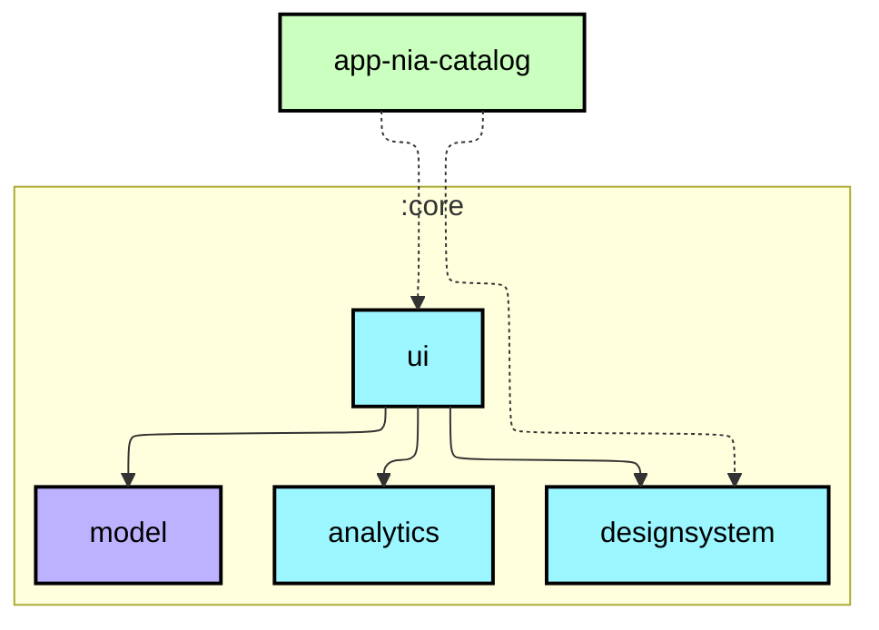
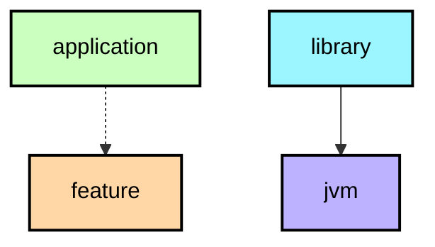

Alright—next step is where StanJarvis starts feeling like a real assistant, not just a chat app.

We’re moving into:

🧠 PHASE 2 — Memory + App Control System

This is what turns your app into something that feels like an “AI OS”.

---

🧠 1. MEMORY SYSTEM (StanJarvis Remembers Things)

🎯 Goal:

StanJarvis remembers:

Your name

Your preferences

Past conversations

Important notes (“remind me…”)

We’ll use a simple local database first:

👉 SharedPreferences (simple version)
Later upgrade to Room DB.

---

📁 MemoryManager.kt

class MemoryManager(private val context: Context) {

    private val prefs = context.getSharedPreferences("stanjarvis_memory", Context.MODE_PRIVATE)

    fun save(key: String, value: String) {
        prefs.edit().putString(key, value).apply()
    }

    fun get(key: String): String? {
        return prefs.getString(key, null)
    }

    fun getAll(): Map<String, *> {
        return prefs.all
    }
}

---

🧠 Upgrade AI to USE MEMORY

Modify AI prompt:

val systemPrompt = """
You are StanJarvis, a smart AI assistant.

You remember user information and use it when relevant.

Be short, helpful, and futuristic.
"""

---

🧠 Example Memory Logic

When user says:

> “My name is Stanley”

You store:

memory.save("name", "Stanley")

Then later:

> “What is my name?”

StanJarvis responds:

Your name is Stanley.

---

📱 2. APP CONTROL (Open apps by voice)

🎯 Goal:

Say things like:

“Open WhatsApp”

“Open YouTube”

“Open settings”

---

📁 AppController.kt

class AppController(private val context: Context) {

    fun openApp(packageName: String) {
        val intent = context.packageManager.getLaunchIntentForPackage(packageName)
        if (intent != null) {
            context.startActivity(intent)
        }
    }
}

---

🧠 Add Smart Command Parser

CommandHandler.kt

class CommandHandler(
    private val appController: AppController,
    private val memory: MemoryManager
) {

    fun handle(command: String): String {

        val text = command.lowercase()

        return when {

            "my name is" in text -> {
                val name = text.replace("my name is", "").trim()
                memory.save("name", name)
                "Nice to meet you, $name"
            }

            "what is my name" in text -> {
                memory.get("name") ?: "I don't know your name yet"
            }

            "open whatsapp" in text -> {
                appController.openApp("com.whatsapp")
                "Opening WhatsApp"
            }

            "open youtube" in text -> {
                appController.openApp("com.google.android.youtube")
                "Opening YouTube"
            }

            else -> "Command not recognized"
        }
    }
}

---

🧠 3. CONNECT MEMORY + AI + COMMANDS

Now update your AI flow:

🔁 NEW FLOW:

Voice Input
   ↓
CommandHandler checks local commands
   ↓
If not command → send to AI
   ↓
AI responds
   ↓
Speak + display

---

🔥 MainActivity update logic

val commandHandler = CommandHandler(appController, memoryManager)

speech = SpeechToTextManager(this) { text ->

    val commandResult = commandHandler.handle(text)

    if (commandResult != "Command not recognized") {
        aiResponse.value = commandResult
        tts.speak(commandResult)
    } else {

        ai.askJarvis(text) { response ->
            aiResponse.value = response
            tts.speak(response)
        }
    }
}

---

⚡ WHAT YOU JUST BUILT

Now StanJarvis can:

🧠 Remember things

Your name

Basic info

📱 Control phone apps

WhatsApp

YouTube

Any installed app (expandable)

🧠 Think like an assistant

Local commands first

AI fallback second

---

🚀 THIS IS A BIG MILESTONE

At this point, your app is no longer just “chat AI”.

It is:

> 🧠 A voice-controlled mini operating system

---

🔥 NEXT UPGRADE OPTIONS

Pick your next evolution:

🟣 Option A — Wake Word System

“Hey StanJarvis” always listening mode

🟢 Option B — Reminders System

“Remind me at 6PM to study”

🔵 Option C — Hologram Avatar UI

Animated Jarvis face + voice reaction

🟠 Option D — Camera Vision

Jarvis can “see” objects and text

---

Just reply with the letter (A, B, C, or D) and we continue building StanJarvis OS step-by-step.# `:app-nia-catalog`

## Module dependency graph

<!--region graph-->

📋 Graph legend

<!--endregion-->
